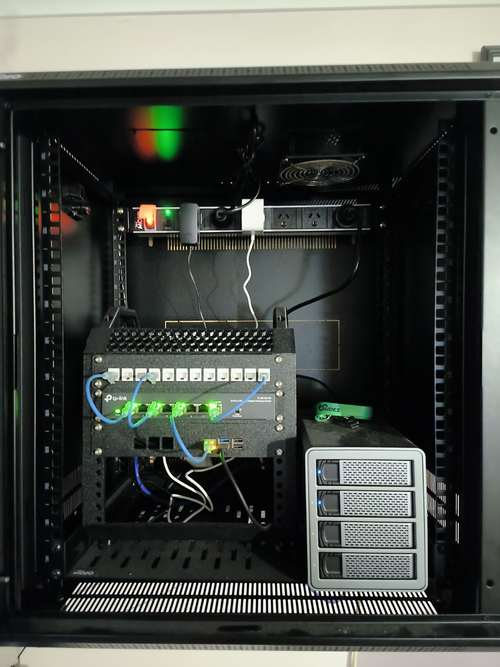
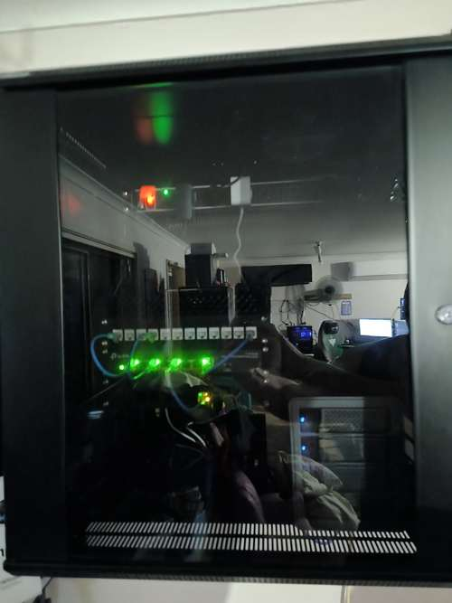

# 👋 Hi, I'm Hamilton Royce Lloyd-Finch

### Cybersecurity | SOC | Penetration Testing | Infrastructure

I'm an Australian early-career cybersecurity professional completing a **Diploma of Information Technology (Cyber Security) at TAFE SA**, following completion of my **Certificate IV in Cyber Security**.

My practical work spans **security operations, penetration testing, vulnerability assessment, Windows and Linux infrastructure, Active Directory, FortiGate, Splunk, Azure, scripting and authorised security research**.

I enjoy working across both **offensive and defensive security** — from reconnaissance, web application testing and vulnerability validation through to monitoring, incident investigation, hardening and remediation.

---

## 🏆 Highlights

- 🥈 **WorldSkills Australia — Cyber Security (2026)**
  - **Silver Medallist — Adelaide Region**
  - **8th place nationally out of 58 competitors**

- ⚔️ **Cyber Battle Australia — National Grand Final (2026)**
  - Team Leader — **Local Host Legends**
  - **9th place nationally**
  - **Personally captured 7 flags**

- ⚔️ **Cyber Battle Australia — National Grand Final (2025)**
  - **Team F-DaS**
  - **18th place nationally**

- 🎓 **Playford Trust / TAFE SA Scholarship (2026)**
  - Scholarship recipient

---

## 🛡️ Cybersecurity

```text
[+] Vulnerability Assessment
[+] Network Security
[+] Penetration Testing
[+] Security Hardening
[+] Security Monitoring
[+] Incident Response
[+] Vulnerability Research
[+] Security Automation
[+] Cybersecurity Frameworks
```

### Frameworks & Security Practices

- NIST Cybersecurity Framework
- Australian Government Information Security Manual (ISM)
- Essential Eight
- ISO/IEC 27002 control concepts
- Vulnerability Management
- Incident Response
- Evidence Integrity & Handling
- Network Segmentation
- Access Control & Least Privilege
- System Hardening

---

## 🧰 Technologies & Tools

### Offensive Security & Vulnerability Assessment

`Kali Linux` · `Burp Suite` · `OWASP ZAP` · `Metasploit` · `Nessus` · `curl` · `Reconnaissance` · `Manual Web Enumeration` · `CVE Analysis`

### Security Operations & Defensive Security

`Splunk Enterprise` · `SPL` · `Fortinet FortiGate` · `Microsoft Defender` · `AppLocker` · `Group Policy` · `Log Analysis` · `Incident Investigation` · `Evidence Integrity`

### Networking & Infrastructure

`TCP/IP` · `VLANs` · `Firewalls` · `Cisco Packet Tracer` · `Windows Server 2022` · `Active Directory` · `DNS` · `DHCP` · `Linux` · `CentOS` · `VMware` · `Samba` · `Pi-hole`

### Cloud & Infrastructure as Code

`Microsoft Azure` · `ARM Templates` · `PowerShell` · `Virtual Machines` · `Azure Storage` · `App Service` · `Cosmos DB` · `AWS CloudTrail` · `Amazon S3 Log Analysis`

### Development & Automation

`Python` · `Bash` · `PowerShell` · `SQLite` · `Git` · `GitHub`

### Platforms & Hardware

`Windows` · `Linux` · `Kali Linux` · `Raspberry Pi` · `Network Storage` · `Home Lab Infrastructure`

---

## ⚔️ Offensive Security & Penetration Testing

My cybersecurity training includes practical offensive-security and penetration-testing work performed in controlled lab environments, CTF environments and authorised testing scopes.

### Areas of Experience

- Passive and active reconnaissance
- Network and service enumeration
- Web application vulnerability assessment
- Manual web application enumeration
- Burp Suite and OWASP ZAP
- Kali Linux
- CVE identification, analysis and vulnerability validation
- Controlled exploitation in lab environments
- Metasploit
- Vulnerability remediation analysis
- Responsible disclosure and bug bounty methodology

### Current Development

I continue developing these skills through:

- authorised bug bounty research
- controlled home-lab testing
- vulnerability validation
- web application analysis
- HTTP request and response analysis
- security research using Burp Suite, curl and browser developer tools
- CTF and cybersecurity competition environments

> Offensive-security activity described here is limited to educational labs, systems I control, CTFs, competitions and explicitly authorised testing scopes.

---

# 🔬 Current Projects

## 🤖 Agentic AI Security Research

I'm currently experimenting with **Agentic AI in cloud environments** to explore how autonomous and semi-autonomous AI systems can assist with vulnerability research.

The project focuses on using AI agents to support security research against **public bug bounty programs listed on HackerOne**, while remaining within each program's authorised scope and rules.

Areas I'm experimenting with include:

- Autonomous reconnaissance workflows
- Web application analysis
- Vulnerability hypothesis generation
- HTTP request and response analysis
- Security research automation
- Agent-assisted investigation
- Evidence collection
- Vulnerability validation workflows
- Reducing false positives
- Structured bug bounty reporting

The goal is not simply to automate scanning, but to investigate how **reasoning-capable AI agents can assist human security researchers throughout the vulnerability discovery process**.

```text
Human Researcher
      │
      ▼
 Agentic AI
      │
      ├── Reconnaissance
      ├── Analyse
      ├── Form Hypotheses
      ├── Test
      ├── Validate
      └── Document
             │
             ▼
      Human Review
```

> All testing is limited to authorised targets and follows the scope, policies and testing requirements defined by the relevant HackerOne program.

---

## 🖧 Home Network Rack & Infrastructure

<p align="center">
  
  
</p>

I maintain my own small network rack and home infrastructure environment, which I use for networking, storage, Linux administration and cybersecurity experimentation.

### Rack Hardware

```text
┌──────────────────────────────┐
│        HOME NETWORK RACK     │
├──────────────────────────────┤
│  Rack-Mounted Power Board    │
├──────────────────────────────┤
│  Network Patch Panel         │
├──────────────────────────────┤
│  8-Port Gigabit Switch       │
├──────────────────────────────┤
│  Raspberry Pi Server         │
│  ├── Pi-hole                 │
│  └── Samba File Server       │
├──────────────────────────────┤
│  4-Bay HDD Storage           │
│  └── Network Accessible NAS  │
└──────────────────────────────┘
```

### 🌐 Networking

The rack includes an **8-port Gigabit Ethernet switch** connected through a patch panel, giving me a central point for managing wired devices around the home.

This provides practical experience with:

- Ethernet infrastructure
- Patch panel organisation
- Network switching
- Physical network management
- LAN troubleshooting
- Network-connected services

### 🥧 Raspberry Pi Server

A Raspberry Pi acts as a lightweight Linux server within the network.

It currently provides:

**Pi-hole**

Network-level DNS filtering and local DNS services.

**Samba**

SMB file sharing for devices across the local network.

The Pi allows me to gain hands-on experience with:

- Linux server administration
- Network services
- DNS
- SMB/Samba
- Permissions
- Storage mounts
- Service troubleshooting
- Remote administration

### 💾 Network Storage

I also operate a **4-bay Direct Attached Storage enclosure populated with HDD storage**.

Rather than connecting the storage directly to individual client computers, the enclosure is attached to the Raspberry Pi.

The Raspberry Pi then exposes the storage to devices across the network using **Samba**, effectively allowing the DAS to operate as my home **NAS**.

```text
4-Bay HDD DAS
      │
      │ USB
      ▼
Raspberry Pi
      │
      │ Samba / SMB
      ▼
8-Port Gigabit Switch
      │
      ├──── Windows PCs
      ├──── Linux Systems
      ├──── Virtual Machines
      └──── Other LAN Devices
```

This project combines networking, Linux administration and storage management in a practical home environment.

---

## 🌡️ Raspberry Pi Temperature Monitoring

I'm also developing a Raspberry Pi-based monitoring system using a waterproof temperature probe and a web-based dashboard.

**Current stage:** Waterproof Temperature Sensor

`Raspberry Pi` · `Python` · `Linux` · `Web Dashboard` · `IoT`

The current implementation reads temperature data from a physical waterproof probe and makes the readings available through a locally hosted web interface accessible from other devices on the network.

---

## 🧪 Cybersecurity Home Lab

I maintain a virtualised cybersecurity environment for practical security testing, infrastructure configuration and defensive-security experimentation.

My lab allows me to work with:

- Windows systems
- Windows Server
- Linux
- Kali Linux
- VMware virtualisation
- Vulnerability scanning
- Network segmentation
- Firewall configuration
- Security monitoring
- Server hardening
- Access control
- Controlled penetration testing

I use the environment to experiment with both **attacker and defender perspectives**, helping me understand not only how vulnerabilities can be identified, but how systems can be hardened and monitored against them.

---

## 🔎 Vulnerability Research

I'm developing practical vulnerability research and responsible disclosure skills through authorised security testing and bug bounty programs.

Areas of interest include:

- Web application security
- Access control vulnerabilities
- Authentication
- API security
- Security misconfiguration
- Information disclosure
- Vulnerability research methodology
- Security automation
- AI-assisted security research

> All security research published here is performed in authorised environments or within the defined scope of responsible disclosure programs.

---

# 🚧 Projects Coming to GitHub

```text
📁 agentic-ai-security-research
├── Agent architecture
├── Research workflows
├── Security automation
├── Experimental tooling
└── Sanitised research findings

📁 cybersecurity-home-lab
├── Network architecture
├── Home network rack
├── Linux services
├── Security controls
└── Defensive security experiments

📁 raspberry-pi-nas
├── Samba configuration
├── Storage architecture
├── Network shares
└── Raspberry Pi administration

📁 vulnerability-management
├── Vulnerability scanning
├── Risk analysis
├── Remediation
└── Verification

📁 raspberry-pi-temperature-monitor
├── Sensor integration
├── Python monitoring
├── Web dashboard
└── IoT experimentation

📁 network-security-projects
├── VLAN segmentation
├── Firewall architecture
├── Network diagrams
└── Secure network design

📁 security-automation
├── Python
├── Bash
├── PowerShell
└── Security utilities

📁 security-research
├── Research methodology
├── Responsible disclosure
├── Bug bounty research
└── Sanitised security write-ups
```

---

# 🎯 Current Focus

I'm currently focused on:

- Completing my **Diploma of IT (Cyber Security)**
- Building a practical cybersecurity portfolio
- Expanding my **SOC and defensive security** capabilities
- Developing my **penetration testing and vulnerability research** skills
- Experimenting with **Agentic AI for vulnerability discovery**
- Conducting authorised research against public bug bounty programs
- Expanding my cybersecurity home lab
- Building Raspberry Pi and network infrastructure projects
- Beginning my professional career in **IT and cybersecurity**

---

# 💡 What Drives Me

Cybersecurity isn't something I only study for a qualification.

I enjoy experimenting with technology, building systems, understanding how they fail and figuring out how they can be made more secure.

That might mean configuring Linux services on a Raspberry Pi, building network infrastructure, managing storage, troubleshooting a virtual environment, competing in cybersecurity competitions or investigating potential vulnerabilities using AI-assisted research workflows.

I'm particularly interested in the point where **cybersecurity, infrastructure, automation and artificial intelligence intersect**.

---

```text
> learn
> build
> break
> understand
> secure
> repeat_
```
